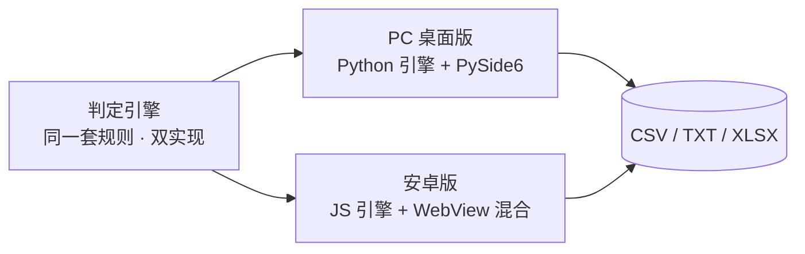

<div align="center">

# 号海捞珍

**在号海之中，捞取属于你的珍宝**

B 站 UID 寻号 · 判定 · 筛选 —— 桌面版 + 安卓版，全引擎本机运行

[](../../actions)
[](#-快速开始)
[](LICENSE)
[](#-测试)

</div>

---

## ✨ 功能一览

- **全区间扫描** — 任意 UID 区间，支持指定尾号（如 0901）
- **五级判定体系** — 极品神号 / 神号 / 注册机号 / 乱码名 / 普通，每级给出成因解释
- **靓号规则** — 顺子、豹子、回文、交替、尾4/尾3；连号位数 3~7 自调（5=标准靓号，4=小靓号）
- **数字偏好** — 不带 4 / 不带 7 / 不含 0 / 额外排除 / 必含数字，自由组合
- **断点续扫** — 中途停止自动记进度，`failed` 状态自动重试，永不丢数据
- **风控应对** — 随机延迟 + 全局冷却退避 + 会话预热（Cookie）+ `-352/-412/-799` 识别
- **一键导出** — CSV / TXT / Excel(xlsx) / 纯 UID 列表，路径自选

## 🏆 判定等级

| 判定 | 含义 |
|---|---|
| 🏆 极品神号 | 三无（0级/0粉/0关注）+ 规范名 + 乱码名 —— 疑似注册机批量注册后遗弃，顶级目标 |
| ✨ 神号 | 三无 + 规范昵称 |
| 🤖 注册机号 | 乱码名 + 0 级，但已有少量粉丝/关注 |
| ❓ 乱码名 | 乱码名但账号已升级 |
| ─ 普通 | 其他 |

## 🏗 架构



- **PC 桌面版**：Python 引擎（`bili_hunter_pro.py`）+ PySide6 玻璃风界面，PyInstaller 单文件 exe
- **安卓版**：WebView 混合架构 —— 判定引擎移植为 JavaScript（`engine.js`），Java 层仅提供联网 / 存文件 / 屏幕常亮三个桥接；**无 Gradle 依赖**，`aapt2 + d8 + apksigner` 极简管线直接产出签名 APK

## 🚀 快速开始

### 下载安装包

前往 [Releases](../../releases) 下载对应平台的安装包（由 CI 自动构建并签名）。

### PC 桌面版

```
pip install PySide6 requests openpyxl
python bili_hunter_gui.py
```

或仅命令行扫描：

```
python bili_hunter_pro.py 1000000 2000000 0901 --threads 4
```

### 安卓版

将 `号海捞珍.apk` 传到手机安装（允许未知来源），详见
[android/使用说明.md](android/使用说明.md)。

## 🛠 自行构建

<details>
<summary><b>桌面版 exe</b></summary>

```
pip install PySide6 requests openpyxl pyinstaller
pyinstaller --onefile --windowed --name 号海捞珍 --icon "2233/icon.ico" ^
  --add-data "2233/1920x1080.jpg;assets" bili_hunter_gui.py
```
</details>

<details>
<summary><b>安卓 APK（无需 Android Studio / Gradle）</b></summary>

准备工具链（约 120MB）：

1. [build-tools r34](https://dl.google.com/android/repository/build-tools_r34-windows.zip)
   （Linux 用 `build-tools_r34-linux.zip`）→ 解压到 `tools/android/`（内含 `android-14/`）
2. [platform android-34](https://dl.google.com/android/repository/platform-34-ext7_r02.zip)
   → 解压到 `tools/android/`（内含 `android-34/android.jar`）
3. JDK 11+

一键构建：

```
cd android && bash build_apk.sh
```

管线：`aapt2 编译资源 → 链接 → javac → d8 → 注入 dex → zipalign → apksigner 签名`
</details>

<details>
<summary><b>CI 自动构建</b></summary>

推送代码到 `main` 分支后，GitHub Actions 自动构建双端安装包
（Actions 页 → Artifacts 下载）；推送 `v*` 标签（如 `v1.0.0`）时自动发布
Release 并附带双端安装包。

> 建议：仓库 Settings → Secrets 中配置 `ANDROID_KEYSTORE_B64`
> （本地 `android/sign.keystore` 的 base64），保证每次构建使用同一签名，
> 用户可覆盖安装升级。
</details>

## 📁 项目结构

```
├── bili_hunter_gui.py      # PC 玻璃风界面（PySide6）
├── bili_hunter_pro.py      # PC 判定引擎 + CLI
├── tests/test_hunter.py    # Python 引擎测试（37 项）
├── android/
│   ├── app/assets/         # 竖屏界面 + JS 判定引擎 + 竖屏壁纸
│   ├── app/src/            # Java WebView 壳（联网/存文件/常亮桥接）
│   ├── test/engine.test.js # JS 引擎测试（40+ 项）
│   ├── build_apk.sh        # 无 Gradle 极简构建管线
│   └── 使用说明.md
└── 2233/                   # 壁纸与图标素材
```

## 🎨 素材版权

`2233/` 目录下的插画壁纸与图标为哔哩哔哩相关插画作品，**版权归原作者所有**，
本项目使用仅限学习研究，请勿商用。若您是权利人并要求移除，请提 Issue。

## ⚠️ 免责声明

本工具仅供技术研究与数据分析。请遵守 B 站用户协议与相关法律法规，
勿用于任何恶意用途（包括但不限于批量注册、账号盗取、骚扰他人）；
因使用本工具产生的一切后果由使用者自行承担。

## License

[MIT](LICENSE) © 号海捞珍 contributors
（`2233/` 素材除外，见上方版权说明）
